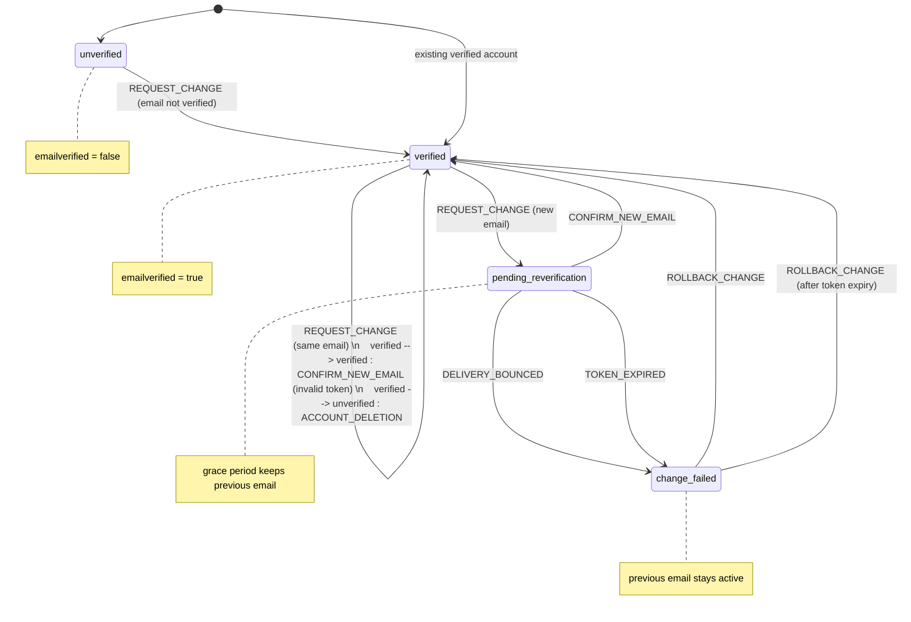

# Email Re‑Verification State Machine

This document describes the explicit state machine governing the process of changing the email address on an already‑verified account.

---

## State Diagram

---

## State Table

| State                     | Description                                                                                     |
|---------------------------|-------------------------------------------------------------------------------------------------|
| `unverified`              | Account has no verified email (`emailVerified = false`).                                        |
| `verified`                | Account has a verified email (`emailVerified = true`). No pending change.                       |
| `pending_reverification`  | User has requested an email change. `pending_email` holds the new address, `emailVerified` stays true on the old address during the grace window. |
| `change_failed`           | Delivery of verification email failed or token expired. The previous verified email remains active. |

---

## Event Table

| Event                | Payload / Guard                                                                                     |
|----------------------|------------------------------------------------------------------------------------------------------|
| `REQUEST_CHANGE`    | `newEmail: string` – must differ from current verified email (case‑insensitive).                     |
| `CONFIRM_NEW_EMAIL` | `token: string` – valid, unconsumed verification token.                                               |
| `DELIVERY_BOUNCED`  | `reason?: string` – optional failure reason.                                                         |
| `TOKEN_EXPIRED`     | –                                                                                                    |
| `ROLLBACK_CHANGE`   | – (allowed from `pending_reverification` or `change_failed`).                                         |

---

## Invariants

1. **Active Verified Email** – While in `pending_reverification`, the previously verified email remains active and `emailVerified = true`.
2. **Bounce / Failure** – Transition to `change_failed` preserves the previous verified email; no loss of verification status.
3. **Rollback** – `ROLLBACK_CHANGE` restores the `previous_verified_email` as the primary `email`, clears `pending_email`, and invalidates any outstanding tokens.
4. **Idempotency** – Re‑processing the same event with identical data must not alter state after the first successful transition.

---

## API Endpoint Contracts

| Endpoint                               | Method | Request Body / Params                               | Response (JSON)                                                                                     |
|----------------------------------------|--------|------------------------------------------------------|------------------------------------------------------------------------------------------------------|
| `/api/auth/email-verify-request`       | POST   | `{ newEmail: string }`                               | `{ state: string, pendingEmail?: string, canRollback: boolean, email: string }`                     |
| `/api/auth/email-verify-confirm`       | POST   | `{ token: string }`                                  | `{ state: string, email: string }` – on success state is `verified`; on failure appropriate error code. |
| `/api/auth/email-change-rollback` (GET) | GET    | –                                                    | `{ state: string, email: string, pendingEmail?: string, canRollback: boolean }`                     |
| `/api/auth/email-change-rollback` (POST) | POST   | –                                                    | `{ state: string, email: string, message?: string }` – performs `ROLLBACK_CHANGE`.

---

## Implementation Notes

* DB columns (`pending_email`, `pending_email_requested_at`, `email_change_status`, `email_change_failure_reason`, `previous_verified_email`) are defined in the migration file.
* The state machine logic lives in `lib/auth/email-reverification.ts`.
* All transitions validate the invariants above and return a `EmailTransitionResult` containing the new state and any side‑effects (e.g., token invalidation).

---

> [!NOTE] The diagram and tables are kept in sync with the TypeScript implementation to avoid drift.
